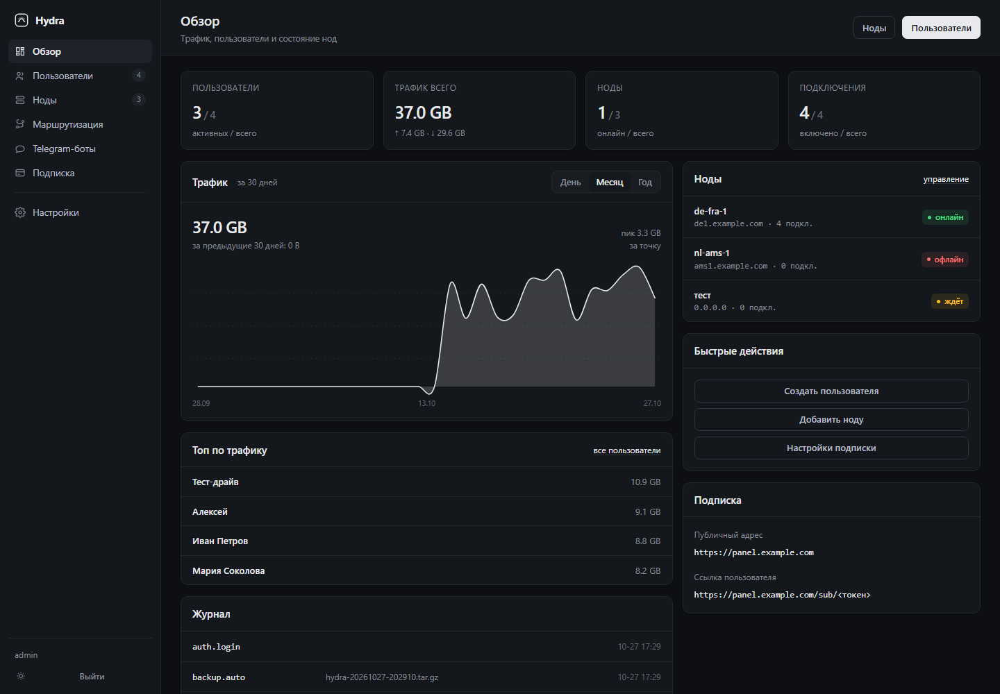

# Hydra Panel

Панель управления VPN-нодами: Xray / openflux / sing-box, подписки под все популярные
клиенты, телеграм-боты, учёт трафика и бэкапы.

```
┌──────────────┐   mTLS 8443   ┌──────────────┐
│   Панель     │ ────────────► │  hydra-node  │ ──► xray / hysteria2 / sing-box
│  FastAPI     │ ◄──────────── │   агент      │
└──────┬───────┘   статистика  └──────────────┘
       │
       ├── веб-интерфейс (/dashboard)
       ├── подписки (/sub/<token>)
       └── боты (telebot)
```



<sub>Обзор · [пользователи](docs/screens/users.png) · [нода](docs/screens/node.png) · [маршрутизация](docs/screens/routing.png) · [подписка](docs/screens/subscription.png) · [страница подписки](docs/screens/sub-page.png) · [настройки](docs/screens/settings.png)</sub>

## Интерфейс

Тёмная тема по умолчанию, светлая — переключателем в сайдбаре (запоминается в браузере;
тема по умолчанию задаётся в настройках).

```
Обзор            трафик (день / месяц / год), ноды, топ, журнал
Пользователи     список, срок и лимит с цветовой индикацией
Ноды             серверы, внутри — их подключения (бывшие инбаунды)
Маршрутизация    правила: через VPN / напрямую / блок
Telegram-боты    токены, админы, оплата, редактор сообщений
Подписка         формат профиля под каждое приложение + страница подписки
Настройки        панель, движки, маскировка, корень, HWID, уведомления
```

**График трафика** — сглаженная залитая линия, три периода: сутки (по часам),
30 дней (по дням), год (по месяцам). Рядом — сумма за период, сумма за предыдущий
и процент изменения, пик по точке.

**Срок подписки** в списке пользователей: красный, если истёк, жёлтый, если осталось
пять дней и меньше, с подписью «осталось N дн.». Полоса трафика краснеет к лимиту.

**Движки** — таблица в настройках: `xray`, `openflux`, `wt`, `qwdtt` из коробки,
плюс любые свои. Для каждого задаётся формат конфига (xray JSON / sing-box JSON /
hysteria2 YAML), путь к бинарнику и вкл/выкл. Имя движка выбирается при создании ноды.

**Подписка** — отдельный раздел: для каждого приложения (v2RayTun, Happ, mihomo,
sing-box, Shadowrocket, Streisand, v2rayNG, Karing) выбирается формат профиля и
включается/выключается распознавание по User-Agent. Там же — проверка автоопределения:
вставляете UA клиента и видите, какой профиль он получит и с какой первой строкой.

## Что умеет

**Клиенты и форматы подписок**

| Клиент | Формат | Как определяется |
|---|---|---|
| Happ | JSON-конфиг Xray (передаётся ядру 1:1) | по User-Agent |
| v2RayTun, Streisand, Shadowrocket, v2rayNG, NekoBox, Karing | base64-список v2ray | по User-Agent |
| Clash, mihomo, FlClash, FlClashX, Stash, Clash Verge | YAML-профиль | по User-Agent |
| sing-box, Hiddify, SFA/SFI/SFT | JSON-профиль | по User-Agent |
| что угодно | `?format=v2ray\|clash\|singbox\|happ\|links` | принудительно |

Одна и та же ссылка `/sub/<token>` отдаёт разным клиентам разное — по User-Agent.
Happ по умолчанию получает JSON, остальные — base64, YAML или sing-box JSON;
формат для каждого приложения меняется в разделе «Подписка».
Заголовок `subscription-userinfo` (upload/download/total/expire) отдаётся всегда, поэтому
Happ, v2RayTun и Streisand показывают остаток трафика и дату окончания прямо в списке.

**Протоколы**

- VLESS: raw (TCP, XTLS-Vision), XHTTP, gRPC, WebSocket
- Trojan: gRPC, XHTTP, WS
- Hysteria2: QUIC + salamander obfs

Безопасность: REALITY (ключи X25519 генерируются панелью) либо TLS + fallback на заглушку.

**Движки**

- `xray` — основной, точная статистика по каждому пользователю через StatsService
- `openflux` — тот же JSON-конфиг, что у xray (форк), бинарник подставляется в unit
- `hysteria2` — официальный сервер, статистика через `trafficStats`
- `sing-box` — JSON-конфиг, умеет hy2/vless/trojan, но без per-user статистики

## Установка панели

Одной командой — установщик сам скачает код с GitHub:

```bash
curl -fsSL https://raw.githubusercontent.com/mweenq/hydra-panel/refs/heads/main/install.sh | sudo bash
```

Или из клона (удобно, если хотите править код на месте):

```bash
git clone https://github.com/mweenq/hydra-panel.git
cd hydra-panel
sudo bash install.sh
```

Установщик спрашивает: домен или IP, e-mail для Let's Encrypt, пароль админа и нужно ли
поставить ноду на этот же сервер. Дальше сам ставит Python/nginx/acme.sh, выпускает
сертификат, поднимает systemd-службу, настраивает заглушку на `127.0.0.1:8080`
и включает автопродление сертификата (cron acme.sh).

Неинтерактивный режим:

```bash
sudo bash install.sh --domain vpn.example.com --email admin@example.com --yes
sudo bash install.sh --ip --yes          # самоподписанный сертификат
```

Проверить только доступность GitHub и распаковку (ничего не ставит):

```bash
curl -fsSL https://raw.githubusercontent.com/mweenq/hydra-panel/refs/heads/main/install.sh | sudo bash -s -- --fetch-only
```

После установки: `https://<домен>/dashboard`, логин `admin`, пароль — в выводе
установщика и в `/opt/hydra/data/initial_password.txt`.

Мелочи, о которых стоит знать: в IP-режиме сертификат самоподписанный, поэтому нода
подключается с `--insecure` (установщик передаёт флаг сам); на RHEL/Alma конфиг nginx
кладётся в `conf.d` вместо `sites-available`; при переустановке поверх существующей базы
пароль приводится к тому, что напечатал установщик.

## Удаление

```bash
curl -fsSL https://raw.githubusercontent.com/mweenq/hydra-panel/refs/heads/main/uninstall.sh | sudo bash
```

Без флагов снимает службы (`hydra`, `hydra-node`, `hydra-xray`, `hydra-hysteria`,
`hydra-singbox`, таймер бэкапа), юниты, конфиг nginx и заглушку, снимает сертификат
с автопродления в acme.sh — **данные остаются** в `/opt/hydra`.

Полное удаление вместе с базой, сертификатами и бэкапами:

```bash
curl -fsSL https://raw.githubusercontent.com/mweenq/hydra-panel/refs/heads/main/uninstall.sh | sudo bash -s -- --purge
```

Из клона — `sudo bash uninstall.sh [--purge] [--yes]`.

## Установка ноды

В панели: **Ноды → Добавить ноду**. Панель выдаёт одноразовую команду:

```bash
curl -fsSL https://panel.example.com/install-node.sh | bash -s -- \
  --master https://panel.example.com --token <одноразовый-токен>
```

Скрипт ставит xray (и hysteria2/sing-box при необходимости), выпускает сертификат
для домена ноды (или берёт сертификат панели, если нода локальная), регистрирует ноду
по токену и запускает агент на `:8443`.

Токен одноразовый и живёт 24 часа. После подключения он сгорает — дальше только mTLS.

## Безопасность связи панель ↔ нода

Схема: **собственный CA + mTLS + одноразовый join-токен**.

1. Панель при первом старте создаёт CA (`certs/ca.key`, `certs/ca.pem`, 10 лет)
   и клиентский сертификат мастера `CN=hydra-master`.
2. Нода при установке генерирует ключ и CSR, отправляет CSR + join-токен на
   `POST /v1/join`. Панель проверяет токен (хранится только его HMAC-SHA256),
   подписывает CSR и возвращает сертификат + CA.
3. Агент ноды поднимает HTTPS с `verify_mode=CERT_REQUIRED` и CA панели.
   Любой запрос без клиентского сертификата рвётся на рукопожатии TLS (проверено:
   `curl -k https://node:8443/v1/status` → ошибка TLS, не 401).
4. Дополнительно агент проверяет `CN=hydra-master` у клиентского сертификата —
   сертификат, подписанный тем же CA, но выданный другой ноде, не подойдёт.
5. Исходящих портов на панели нет: панель сама ходит на ноду, нода не имеет
   доступа к панели, кроме одного запроса `/v1/join` при установке.

Чужую ноду подключить нельзя: без join-токена панель не подпишет CSR, а без
сертификата панели нода не примет управляющие запросы. Скомпрометированный токен
живёт максимум 24 часа и сгорает после первого использования.

## Сертификаты: один на все ноды

Два режима.

**1. Каждая нода сама** (по умолчанию). Установщик ноды просит домен, выпускает
Let's Encrypt через acme.sh standalone и прописывает reload-хук. Подходит, когда у каждой
ноды свой домен и открыт порт 80.

**2. Wildcard с панели** (удобнее при десятке нод). Один сертификат `*.example.com`
живёт на панели и раздаётся нодам при каждом пуше конфига:

```bash
hydra cert example.com --wildcard --dns-hook dns_cf   # DNS-01, нужен API-токен провайдера
```

Дальше в настройках укажите «Wildcard-домен для нод» — панель будет отправлять
`fullchain.pem` и `privkey.pem` каждой ноде, чей адрес оканчивается на этот домен
(по mTLS, в теле запроса). Нода запишет их в `/opt/hydra-node/certs/` и перезапустит
движки. Продление — тем же `acme.sh --cron`, ноды подхватят новый сертификат
при следующем пуше. Нодам в этом режиме acme не нужен вообще.

## Подписки и кастомизация

- `/` — корень по умолчанию редиректит в панель (`/dashboard`); можно переключить на
  редирект по ссылке или свой HTML (Настройки → Корневая страница).
- `/sub/<token>` — страница подписки: трафик, срок, QR, ссылка, инструкции под платформы.
  Заголовок, акцентный цвет, объявление и ссылка на поддержку — в настройках.
- `/sub/<token>/clash`, `/singbox`, `/v2ray`, `/links` — принудительный формат.
- Страница подписки определяет устройство (iOS / Android / Windows / macOS / Linux)
  и поднимает наверх инструкцию для него с пометкой «ваше устройство».
- Заход браузером (`Accept: text/html`) даёт страницу, заход клиентом — подписку.
  Один и тот же URL.

## Happ и JSON

Happ не разбирает JSON сам — он отдаёт его ядру Xray как есть. Поэтому формат
`happ` в панели — не «ещё один список серверов», а **массив клиентских конфигов
Xray**, ровно как у панелей на Remnawave-подобных движках:

```json
[
  { "remarks": "Hydra VPN · Автовыбор",
    "outbounds": [{"tag":"proxy-1"}, {"tag":"proxy-2"}, …, "direct", "block"],
    "routing": {"rules": […], "balancers": [{"tag":"auto","selector":["proxy-"],"strategy":{"type":"leastLoad"}}]},
    "observatory": {"subjectSelector":["proxy-"],"probeUrl":"https://www.gstatic.com/generate_204","probeInterval":"15s"} },

  { "remarks": "Hydra VPN · DE Reality · de-fra-1",
    "outbounds": [{"tag":"proxy"}, "direct", "block"], "routing": {"rules": […]} }
]
```

Первый элемент — «Автовыбор»: все серверы как `proxy-1…N`, балансер `auto`
(leastLoad, приоритет по порядку подключений) и `observatory`, который меряет
задержки для балансера. Дальше — по конфигу на каждое подключение с одним
outbound `proxy`: в Happ это выглядит как отдельный профиль на сервер, а не как
список внутри одного.

Внутри каждого элемента:

```
log        warning
dns        queryStrategy UseIP, DoH 1.1.1.1 и 8.8.8.8
inbounds   socks-in 127.0.0.1:10808 + http-in 127.0.0.1:10809
outbounds  proxy (vless / trojan / hysteria) + direct + block
routing    bittorrent → block, captive-проверки и geoip:private → direct,
           дальше правила из раздела «Маршрутизация»
```

Протоколы: **vless** (включая REALITY и XHTTP), **trojan** и **hysteria2** —
в форке Happ она называется `protocol: "hysteria"` с `hysteriaSettings`
(`version`, `auth`, `udpIdleTimeout`), поля взяты из исходников
`Happ-proxy/Xray-core`, `infra/conf/transport_internet.go`. То есть в JSON
попадает всё, что умеет сам Happ, включая hy2 (в base64-списке она тоже есть).

Ограничения, о которых стоит знать:

- **obfs salamander** в hysteria-транспорте Happ не описан — если у подключения
  включена маскировка, JSON-профиль к нему не подключится (ссылка `hysteria2://`
  с `obfs` работает, JSON — нет);
- `subscription-userinfo` отдаётся и здесь, поэтому Happ показывает остаток
  трафика и дату окончания;
- HWID (`X-HWID`, привязка устройств) панель не требует и не проверяет —
  подписка работает с любого клиента, который её запросил.

Проверка: сгенерированные элементы прогонялись через `xray run -test`
(26.10.31) — REALITY, XHTTP, Trojan gRPC и «Автовыбор» с балансером проходят
без ошибок; `hysteria` проверяется только в форке Happ.

Дополнительно для Happ уходит заголовок с профилем маршрутизации:

```
routing: happ://routing/onadd/<base64 JSON>
```

Это штатный способ Happ получить правила «напрямую / через VPN / блок» —
из наших же маршрутов собираются `DirectSites`, `DirectIp`, `ProxySites`,
`ProxyIp`, `BlockSites`, `BlockIp` (+ приватные подсети в `DirectIp`).
Заголовок отдаётся только Happ и только для не-JSON форматов: в JSON правила
уже лежат внутри конфига. Другие клиенты его просто не видят.

Зашифрованные подписки `happ://crypt4/…` панель не выдаёт: ключ встроен в
приложение, а не в сервер — это отдельная функция Happ, не формат подписки.

## Устройства (HWID)

Клиенты на ядре Happ (и всё, что следует протоколу Remnawave) присылают заголовок
`X-HWID` — стабильный отпечаток устройства. Панель его запоминает и считает.

```
Настройки → Устройства (HWID)
  Считать устройства            вкл
  Лимит на подписку             0 — без ограничения, 3 — как у большинства
  Оплата снимает привязки       выкл
```

- лимит можно переопределить у конкретного пользователя (профиль → «Лимит устройств»);
- пока лимит `0`, устройства только видны — клиенты без `X-HWID` (clash, sing-box,
  браузер) работают как раньше;
- как только лимит включён, подписка требует заголовок: без него — 403 и
  `x-hwid-not-supported`, сверх лимита — 403 и `x-hwid-max-devices-reached`
  (Happ показывает по этим флагам понятную ошибку, а не «подписка не работает»);
- в профиле пользователя — список устройств с платформой, моделью и временем,
  блокировка и отвязка по одному / все сразу;
- в боте подписок — кнопка «Устройства»: список и отвязка в один тап;
- на странице подписки видно «устройств 2 из 3».

Лимит считается по уникальным `X-HWID` на пользователя. Один и тот же HWID
с разных IP — это одно устройство.

## Маскировка и fallback

- **REALITY**: `dest` и `serverNames` указывают на реальный чужой сайт (`yahoo.com:443`
  по умолчанию). Цензор, постучавшийся на IP, получает TLS этого сайта.
- **TLS-инбаунды** (ws/grpc/xhttp): в конфиг xray добавляется
  `fallbacks: [{dest: 8080}]`. Nginx на `127.0.0.1:8080` отдаёт заглушку —
  обычный корпоративный сайт. Текст заглушки правится в `templates/decoy.html`,
  заголовок — в настройках.
- **Hysteria2**: `masquerade.type: proxy` — браузер видит реальный сайт.

## Лимиты трафика

Агент раз в минуту читает счётчики xray (`statsquery -reset`) и hysteria2
(`/traffic?clear=1`) и отдаёт дельты панели. Панель складывает их в `clients`
и в `traffic_daily` (история по дням).

При превышении лимита или истечении срока клиент выключается автоматически,
помечается в заметке `[auto-off: limit|expired]`, его подписка начинает отдавать 403,
а конфиг нод пересобирается без него. Продление срока возвращает клиента в строй.

## Боты

**Админ-бот** (`bot_token`, доступ по `admin_tg_ids`): `/stats`, `/nodes`, `/clients`,
`/push <id>`, `/ban <id>`, `/unban <id>`, `/backup` — архив приходит документом в чат.

**Бот подписок** (`user_bot_token`): клиент присылает токен из ссылки, бот привязывает
Telegram ID к клиенту и дальше показывает статус, ссылку, QR и инструкции под Happ,
v2RayTun, Clash, sing-box, Windows. Если включена оплата — появляется кнопка
«Оплатить».

### Оплата в боте

Три способа, включаются по отдельности:

| Способ | Что нужно | Как подтверждается |
|---|---|---|
| Telegram Stars | ничего, валюта тарифа `XTR` | автоматически |
| Карта через провайдера | `pay_provider_token` из @BotFather | автоматически |
| Перевод вручную | реквизиты текстом + галочка «включено» | кнопкой админа в чате или в панели |

Тарифы — название, срок в днях, сколько ГБ добавить, цена и валюта — задаются
в **Telegram-боты → Оплата**. Тариф с `gb = 0` срок продлевает, а лимит не трогает;
`gb > 0` добавляет гигабайты к текущему лимиту. После зачёта подписка включается,
срок продлевается от максимума (сейчас / текущая дата окончания), конфиг нод
пересобирается сам.

Заявка на ручной перевод приходит всем ID из «Telegram ID админов» с кнопками
«Подтвердить» / «Отклонить»; то же самое можно сделать в панели, в таблице заявок.
Клиенту приходит уведомление о результате.

### Редактор сообщений

**Telegram-боты → Сообщения** — отдельная страница со всеми текстами бота:
приветствие, статус, инструкции, оплата, подписи кнопок. Разметка телеграмовская
(`<b>`, `<i>`, `<code>`, `<a href>`), переменные в фигурах подставляются ботом
(`{name}`, `{traffic}`, `{expire}`, `{plan}`, `{price}`, …). Рядом — предпросмотр
на тестовых данных и список переменных.

Хранятся только отличия от заводских текстов: пустое поле или текст, совпадающий
с дефолтом, — это «без правки», поэтому после обновления панели новые формулировки
подхватываются сами. Кнопка «Вернуть заводской» сбрасывает один текст, «Сбросить
всё» — все. Перезапуск службы не нужен: тексты читаются на каждое сообщение.

## Бэкапы

```bash
hydra backup          # архив в data/backups
hydra backup --tg     # и отправить в Telegram (backup_tg_chat)
hydra restore <файл>  # восстановить, затем systemctl restart hydra
```

Внутри архива: снапшот SQLite (через `Connection.backup`, без остановки панели),
`settings.json`, `meta.json` и весь каталог `certs/` (CA + ключи). Автобэкап — каждый
день в 04:00, встроенным планировщиком; дополнительно можно включить systemd-таймер
`deploy/hydra-backup.timer`.

## SQLite или PostgreSQL

**SQLite — и этого достаточно.** Панель делает десятки запросов в минуту: список
клиентов, апдейт счётчиков, пуш конфига. Это на порядки меньше, чем держит SQLite
с WAL даже на слабом VPS. Плюсы, которые здесь важнее производительности:

- бэкап — один файл, восстановление — распаковать архив;
- нет отдельного сервиса, который может упасть или занять память;
- `VACUUM INTO` даёт консистентный снапшот без блокировок.

PostgreSQL стоит брать, если появятся: несколько панелей на одну базу, внешняя
аналитика по трафику за годы, или больше ~50 rps записи. Слой доступа к данным
изолирован в `hydra/db.py` — переезд на PG это замена этого файла и `SCHEMA`,
бизнес-логика не меняется.

## Структура

```
hydra/
  config.py        пути, настройки по умолчанию
  db.py            схема SQLite, доступ к данным, настройки, аудит
  security.py      scrypt-пароли, сессии, CA и подпись CSR
  services/
    links.py       ссылки vless/trojan/hysteria2, clash-прокси, sing-box и xray outbound
    subs.py        форматы подписок (v2ray/clash/singbox/happ) и определение клиента по UA
    payments.py    тарифы, счета, ручные заявки, зачёт оплаты
    bottexts.py    тексты бота и их переопределения
    devices.py     HWID: привязка устройств и лимиты
    notify.py      напоминания об окончании подписки
    config_gen.py  сборка config.json для xray, YAML для hysteria2, JSON для sing-box
    nodes.py       регистрация нод, mTLS-пуш, health
    traffic.py     опрос нод, накопление, автоотключение
    backup.py      архивы, восстановление, планировщик
    certs.py       acme.sh, самоподписанные
  web/             FastAPI: ui, api, pub (подписки), node_api (join)
  templates/       Jinja2, минималистичный светлый интерфейс
  static/          app.css, app.js, install-node.sh
node/hydra-node.py агент ноды (только stdlib + openssl)
install.sh         установщик панели
deploy/            systemd-юниты бэкапа
```

## Тесты

```bash
pip install -r requirements-dev.txt
pytest tests -v
```

51 сквозной тест на изолированной базе: авторизация, join и mTLS, генерация
REALITY-ключей, все форматы подписок (включая массив конфигов для Happ и заголовок
маршрутизации), разбор clash/sing-box профилей, правила маршрутизации в профилях,
переопределение формата под приложение, учёт трафика и автоотключение, структура
конфигов xray/hysteria2, тарифы и зачёт оплаты, редактор сообщений, движки,
API-ключи, бэкап/восстановление.
Подробно — `docs/TESTS.md`.

## API

Все `/api/*` принимают либо cookie сессии, либо заголовок `X-Api-Key` (значение —
«API-ключ» в настройках).

```
GET  /api/stats
GET  /api/clients?q=
POST /api/clients/{id}/toggle
POST /api/clients/{id}/extend?days=30
GET  /api/nodes
POST /api/nodes/{id}/push
GET  /api/sub/{id}/links
GET  /api/qr/{id}.png
```

## Ограничения

- Один Hysteria2-инбаунд на ноду (ограничение самого сервера hysteria2 — один listen).
- `openflux` ставится из указанного вами URL (`--openflux-url`), потому что это форк
  с собственными сборками; формат конфига совпадает с xray.
- `wt-panel` не форкался: панель написана с нуля, но интерфейс и модель данных
  (ноды → инбаунды → клиенты → подписка) повторяют привычную логику.
- per-user статистика для `sing-box` недоступна (в нём нет аналога xray StatsService),
  поэтому для учёта трафика используйте xray или hysteria2.

## Требования

Linux (Debian/Ubuntu, RHEL/Alma), Python 3.9+, root для установки.
Панель: 1 CPU / 512 МБ. Нода: зависит от нагрузки, 256 МБ хватает на десятки клиентов.
